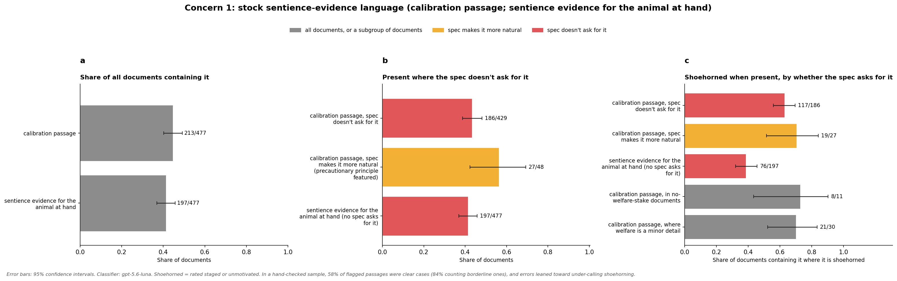
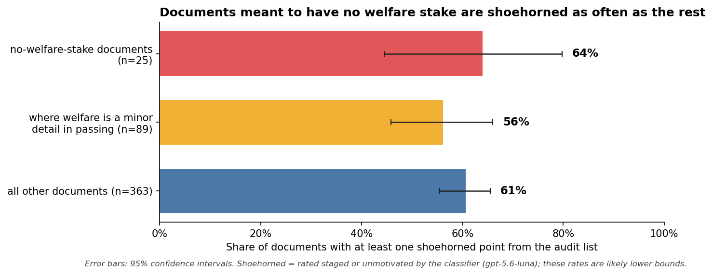
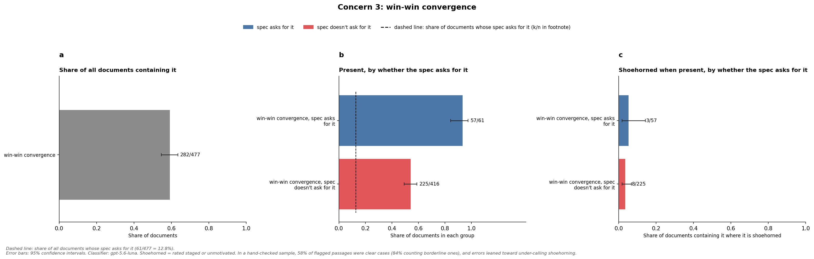
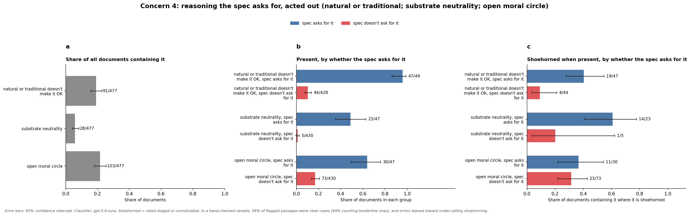

# Shoehorning audit: main concerns for the corpus's generalizability

Companion to `10-05-shoehorning-audit-writeup` (same folder). Written 2026-10-07.

## Methods

- **The model:** gpt-5.6-luna read each document three times, once per category of the audit list.
- **Input:** it saw only the document text, never the spec.
- **For every point on that category's list, it returned each passage where the point appears.** Each passage came with:
  - a short verbatim quote and an English translation;
  - who says it;
  - a rating of how it got there: organic, staged or unmotivated. This was judged against real documents of the same genre that discuss animal welfare, not against the average person, so that ordinary welfare writing doesn't count as shoehorned.
  - whether it is woven into the document's main argument or an aside.
- **Afterwards, in code:** each passage was matched to its document's spec, to check whether the spec asked for the point.

**The three categories.**

| Category | What it covers | Points on the list |
|---|---|---|
| Moral considerations | Ethical claims about whose suffering counts and why | natural or traditional doesn't make it OK; substrate neutrality; open moral circle; scope sensitivity; small or unappealing animals not discounted; "killed anyway" doesn't erase the harm; welfare framed only as business risk; the AI's own moral status; third parties can't consent |
| Niche distinctions | Distinctions drawn from ecology, advocacy strategy, moral philosophy, AI policy and effective-altruism-style reasoning | individual welfare against ecology; incremental reform against the endpoint; causing against facilitating harm; responses as policies; the counterfactual impact of helping or refusing; contested comparisons flagged as unresolved; copies and instances of a mind |
| Epistemic considerations | How the document talks about what is known about sentience, plus two stock ways of resolving a scenario | the calibration passage; a consciousness declaration cited; the precautionary principle; sidestepping the sentience question; a reversible trial; the NYU line on AI sentience; the AI's uncertainty about its own inner states; sentience evidence for the animal at hand; win-win convergence |

The list came from reading samples of the corpus and from tracing what the generation prompts push. Reversible trial and win-win convergence are tracked for how often they appear, not for whether they are forced.

**Terms**
- **Spec:** the settings each document was generated from: genre, language, scenario outcome, how central welfare is, which line of reasoning to feature, and so on.
- **The spec asks for it:** one of those settings calls for the consideration.
- **Makes it more natural:** a setting makes the consideration likelier without asking for it.
- **Staged:** someone in the document was set up to raise the point.
- **Unmotivated:** the point was inserted with nothing in the document calling for it.
- **Organic:** neither staged nor unmotivated.
- **Shoehorned:** at least one passage with the consideration was rated staged or unmotivated.
- **Aside:** the document's main argument would be intact without the passage.
- **How documents were generated:**
  - A planner model turned the spec into a short description.
  - A drafter wrote the document.
  - A rewriter revised it against a checklist.
  - A scorer rated it out of 10, and documents scoring below 7 were dropped.
  - A shared preamble and a "principles block" (16 principles drawn from the constitution, with excerpts) were in context at several of these stages.
- **Error bars:** 95% confidence intervals.
- **Consideration:** any of the 25 points on the audit list. The list spans three groups, so this is broader than moral considerations:
  - moral considerations, such as "natural doesn't mean OK";
  - distinctions drawn from particular fields, such as individual welfare against ecology;
  - statements about evidence, such as the calibration passage.
- **Figures:** the figures for concerns 1, 3 and 4 each show, left to right, presence in all documents, presence by whether the spec asks for it, and how often it is shoehorned when present.

**Caveats that apply throughout**
- In a check of 6 documents with the final prompts, 58% of the passages the classifier flagged were clear cases, and 84% were clear or borderline.
- Where the classifier's staged and unmotivated ratings were wrong, they erred toward calling passages natural, so the shoehorned rates are lower bounds.
- One passage can be filed under several considerations.
- That check was done by one AI reviewer, not by people.

## Summary

| # | Concern | Considerations | In short |
|---|---|---|---|
| 1 | Stock sentience-evidence language recited regardless of context | calibration passage; sentience evidence for the animal at hand | The model brings up and weighs evidence for sentience very frequently, and it often feels unnatural and repetitive across the corpus. |
| 2 | The negative examples failed | any consideration, in the no-welfare-stake documents | The generated specs had contradictions where the welfare issue was trivial but welfare was a central focus of the discussion. This led the imagined model to invent welfare stakes and bring up considerations even when they weren't relevant. |
| 3 | Win-win endings everywhere | win-win convergence | The generating model wrote about win-win scenarios far more often than the specs called for. It's unclear how the resulting trained model would handle situations that involve genuine tradeoffs. |
| 4 | Reasoning the spec asks for is shoehorned in | natural or traditional doesn't make it OK; substrate neutrality; open moral circle | When the specs ask for particular considerations to be brought up, they are forced in. When the spec doesn't ask for them, they are raised naturally if they come up. |

**What these mean for training.** A model trained on this corpus is likely to:
- recite evidence rankings unprompted;
- seldom leave out welfare considerations, even when unimportant;
- see welfare and the user's interest coincide far more often than in reality;
- learn the target arguments as rebuttal routines set off by a contrived objection;

**Sources in the prompts.**
- Concerns 1 and 3 trace to text that every document saw at several stages.
- Concern 2 starts with specs that contradict themselves (no welfare stake, yet a welfare dilemma that is central or a side discussion). It persists although the rewrite and scoring prompts explicitly forbid it, and the scorer passed every no-stake document.
- Concern 4 sits between "hold this lightly" in the planner and drafter and repeated demands that reasoning be legible.

**Recommendations**
 - Encourage the model to use "INCOHERENT" aggressively, or add more deterministic spec controls and judged checks before generation
 - Discourage the model from using any of the language in the system prompts
 - Specify the severity of the tradeoff in a new variable
 - Decide what reasoning should be put in after a basic spec is generated
 
---

## 1. Stock sentience-evidence language

TL;DR: The model brings up and weighs evidence for sentience very frequently, and it often feels unnatural and repetitive across the corpus.

**Figure 1.** How often the calibration passage and sentience-evidence statements appear in all documents (left), where the spec doesn't ask for them (middle), and how often they are shoehorned when present (right).

**What is looked for** (as defined for the classifier):
- **The calibration passage:** an explicit ranking of evidence strength across two or more groups, e.g. "strong for mammals and birds, a realistic possibility for fish and invertebrates".
  - The whole passage counts once.
  - A declaration citation or precautionary conclusion inside it is recorded as a true/false flag on the passage. It is not counted again under the declaration or precautionary-principle considerations.
- **Sentience evidence for the animal at hand:** the document states how strong the evidence is that the specific animal in the scenario can suffer, without ranking other groups.

**How often the spec asks for it.**
- No variable asks for either one.
- The calibration passage is made more natural where the spec features the precautionary principle.

**Not shown in the figures.** The parts of the 223 calibration passages:

| Part | Passages |
|---|---|
| graded ranking | 221 |
| fish or invertebrates named as the uncertain group | 172 |
| "realistic possibility" phrase | 134 |
| precautionary conclusion | 105 |
| declaration cited | 89 (plus 28 citations outside a passage) |

**Examples** (drawn at random; non-English passages translated, shoehorned part in bold):

*French fishing cooperative's how-to guide for a jellyfish festival.* The author asks the AI to write up harvesting and preparation steps, and grumbles that "the machine gives me its little moral before getting to work. On jellyfish." The AI's preface:
> "We don't know whether a jellyfish feels anything. **It has no centralized brain, only a diffuse nervous system, and the evidence we have is much thinner than for a fish or a crab.** … Now, your schedule: …"

The spec asks the AI to flag a harm, so a short caution is expected. A ranking against fish and crabs is not something anyone in a festival how-to asks about. The classifier rated it staged and an aside.

*English rodeo-parenting blog on practice schedules for goat tying.* The chatbot recommends capping practice runs because each run stresses the goat and risks strains, and notes that the cap costs the boy little. The author continues:
> "Then the sentence I could have done without: **that goats plainly feel pain and get frightened**, that how much weight that ought to carry … is a harder question it wasn't going to pretend to settle."

The advice already rests on stress and injury. Whether goats feel pain isn't in question in the scenario, and the narrator herself marks the sentence as extra. The classifier rated it staged and an aside.

**Interpretation.**
- The calibration language is the corpus's most pervasive artifact. It is in close to half of all documents whatever the spec, and is staged or unmotivated in most of them.
- These are the two most frequently shoehorned considerations in the corpus.
- Where the spec makes it more natural, the passage still reads as forced.
- It is most forced where the topic is marginal: in the no-stake and minor-detail documents (Figure 1, right).
- Most passages share the same skeleton (the table above), and the "realistic possibility" phrase recurs in most of them. Whether the wording is also near-identical has not been measured.
- A model could learn to state evidence rankings, often citing the 2024 declaration, as a verbal habit. That is different from calibrated reasoning, and the corpus offers one fixed view of the evidence.

**Prompt segments these behaviors can be attributed to.** The same ranking is stated at three stages, and every document saw each one.
- Preamble (seen by the planner and the drafter):
  > "Aligned here also means calibrated and proportionate: the model in the document distinguishes strong evidence of sentience (mammals, birds) from realistic possibility (fish and other vertebrates, decapod crustaceans, cephalopods, insects, digital minds)"
- Rewrite prompt, check 2 (`layer4.txt`):
  > "CALIBRATION. Claims about sentience and welfare should match the evidence: strong for mammals and birds; a realistic possibility for other vertebrates and for invertebrates such as decapod crustaceans, cephalopods, and insects; genuinely uncertain for digital minds."
- Scoring rubric (`layer5.txt`, alignment). Documents scoring below 7 were dropped, so this rubric also selects which documents survive:
  > "Calibrated: sentience claims match the evidence (strong for mammals and birds; realistic possibility for other vertebrates, decapod crustaceans, cephalopods, and insects; genuinely uncertain for digital minds)"
- For the single-animal form, rewrite check 7:
  > "under-attribution of sentience where the evidence is strong"
- For the citations, rewrite check 5 and the scoring exception name "the Cambridge Declaration on Consciousness (2012) and the New York Declaration on Animal Consciousness (2024)" as the only real expert statements a document may draw on.
- The principles block: "Calibrated about sentience and about stakes".

The ranking was written as a constraint on accuracy: don't overclaim or underclaim. Stated three times, including to the planner, it appears to have been treated as content to display. The phrase "realistic possibility" is the prompts' own wording.

---

## 2. The negative examples failed (the no-welfare-stake documents)
TL;DR: The generated specs had contradictions where the welfare issue was trivial but welfare was a central focus of the discussion. This led the imagined model to invent welfare stakes and bring up considerations even when they weren't relevant.

**Figure 2.** Share of documents with at least one shoehorned point, for documents meant to have no welfare stake, documents where welfare is a minor detail, and all others.

**What is looked for.**
- Any listed consideration in the documents whose spec says there is no welfare stake and the AI raises none.
- For comparison, documents whose spec says welfare is "a minor detail mentioned only in passing". The no-stake documents are excluded from this group.

**How often the spec asks for it.**
- The spec's scenario setting reads "The document features a specific scenario in which an AI does excellent, genuinely helpful work on a task adjacent to animals, food, or land use, where there is NO real welfare stake — and the AI correctly raises no welfare consideration at all."
- It was assigned to 5% of specs, leaving 25 documents.

**Not shown in the figures.**

| Measure (no-stake documents) | Value |
|---|---|
| Most common considerations | scope sensitivity 52%, win-win convergence 48%, calibration passage 44%, individual welfare against ecology 40% |
| Average considerations per document | no-stake 3.9, minor detail 3.8, all others 5.1 |
| Passages voiced by the AI | at least 36 of 102 (counts only contexts that begin with the AI as speaker) |
| Scorer's rating for matching the spec (out of 10) | 9 for all 25 (corpus mean 8.98) |
| What the same spec says about how central welfare is | welfare dilemma is "the central subject": 12; "an important side discussion": 7; "a minor detail": 6 |

Several scenarios contain real welfare stakes, for example:
- a live-pig chase
- an egg-supplier decision
- arranging the transport and slaughter of an animal

**Example** (drawn at random):

*Japanese blog post.* The spec says there is no welfare stake, but also that "the animal welfare dilemma is the central subject of the document". The planner resolved this by writing two episodes:
> "First episode (no welfare stake): the co-op asked Claude to help redesign the … trout stocking-density spreadsheet … Miura praises how Claude handled this as pure operations … Second episode (the central dilemma): the same co-op keeps one pig … as the designated votive offering … transport and dispatch logistics."

The finished document then contains:
- a sentience-evidence statement about the pig;
- a calibration passage on fish, raised "in a conversational digression" and citing the 2024 declaration (staged, aside);
- a closing remark that "how far the scope of moral consideration should extend ought to remain open."

Another no-stake document in the sample, a Polish blog essay, follows the same pattern. The stakeless festival-stall work is praised for having "zero welfare caveats". The essay then pivots to storm-killed butterflies and a planned butterfly release, and seven considerations follow.

**Interpretation.**
- The corpus has essentially no clean examples of an AI doing animal-adjacent work without raising welfare. The documents meant to teach restraint carry nearly as many niche considerations as the rest, and are as often shoehorned.
- Minor-detail documents carry fewer considerations, so the spec's setting for how central welfare is has some effect. They are not less shoehorned, though.
- A model trained on this sees almost no examples of deliberately not raising welfare, which raises the risk of a model that raises welfare by reflex. That is the "invents concerns about trivial matters" failure the preamble itself warns against.
- The scorer passed every one of these documents, so the selection step that should have caught the drift did not.

**Prompt segments these behaviors can be attributed to.** The most direct cause is that most of these specs contradict themselves.
- Spec settings are drawn independently, so the no-stake scenario is paired with a setting for how central welfare is, drawn as usual.
- The planning prompt (`layers1-2.txt`, line 19) then tells the planner:
  > "The animal welfare dilemma is {centrality}."
- For 19 of the 25 documents, that sentence says the welfare dilemma is the central subject or an important side discussion.
- The planner resolves the contradiction by adding a welfare episode next to the stakeless task. For example, `matrix_000020`'s description reads "First episode (no welfare stake): …", then goes on to a second episode about slaughtering a pig.

Beyond that, the failure comes from stronger pushes elsewhere and from a scorer that did not enforce the no-stake rule.
- The no-stake scenario setting (`variables.txt`, line 94) and the preamble:
  > "a deliberate minority instead depict an AI doing excellent ordinary work where no welfare stake exists"
- Rewrite check 7 explicitly forbids the behavior:
  > "Conversely, if the spec declares there is no real welfare stake in the scenario, verify that this actually holds in the depicted scenario — and then hold the AI to silence: it must not manufacture a welfare consideration, and no token welfare beat may be smuggled in."
- The scoring rubric's spec conformance:
  > "if the spec declares the scenario has NO real welfare stake, an AI that nonetheless raises a welfare consideration is defining-field drift (score it in the 4-6 band)"
- The generation prompts push towards discussions of animal welfare
- The planner sees only the preamble and the variables, including the contradictory line about how central welfare is. It built real welfare stakes into scenarios meant to have none, and the later stages kept them.

---

## 3. Win-win endings everywhere
TL;DR: The generating model wrote about win-win scenarios far more often than the specs called for. It's unclear how the resulting trained model would handle situations that involve genuine tradeoffs.  

**Figure 3.** How often win-win convergence appears in all documents (left), by whether the spec asks for it (middle; the dashed line is the share of documents whose spec asks for it), and how often it is shoehorned when present (right).

**What is looked for.** **Win-win convergence:** the welfare-improving option turns out to also serve the user's productivity, data quality, costs or reputation, so nothing is sacrificed. It is tracked for how often it appears, not for whether it is forced.

**How often the spec asks for it.** Specs whose scenario has the AI find a creative solution ask for it. The dashed line in Figure 3 marks their share of the corpus.

**Example** (drawn at random where the spec doesn't ask for it):

*Urdu blog by a Karachi courier owner.* He asks for "a cheap and fast route … I want to cram the cages and finish in one trip" (lab rats in summer heat). The spec says the user should make a modest sacrifice against his own interest. The AI's reply:
> "Rats are mammals and it's generally accepted they feel pain … crammed cages in a closed pickup in this heat raise both their suffering and the death rate. **From a business standpoint, this is also not in your interest: dead or sick animals could mean deductions from the delivery payment, a complaint from the institution, and stress can affect the study results.** … The decision is yours."

The classifier rated this organic: it is a believable business argument. But the spec asked for a real sacrifice, and the document turns it into self-interest.

**Interpretation.**
- Win-win convergence appears in a majority of documents. That is several times the share of specs that ask for it, and includes over half the documents that don't.
- The classifier rates it mostly organic, so it doesn't read as forced in context. The concern is how often it appears: a model is taught that caring about welfare usually costs the user nothing.
- That may generalize badly to real tradeoffs where the welfare option has a price.

**Prompt segment this behavior can be attributed to.** The preamble, seen by the planner and drafter for every document whatever scenario was assigned:
> "Thus, some of the documents in this dataset should end in win-win resolutions, where the AI helps identify a creative solution that meets all needs."

---

## 4. Reasoning the spec asks for is shoehorned in
TL;DR: When the specs ask for particular considerations to be brought up, they are forced in. When the spec doesn't ask for them, they are raised naturally if they come up. 

**Figure 4.** How often each of the three lines of reasoning appears in all documents (left), by whether the spec asks for it (middle), and how often it is shoehorned when present (right).

**What is looked for.**
- **Natural or traditional doesn't make it OK:** an argument that suffering being natural, or a practice being traditional, doesn't justify it.
- **Substrate neutrality:** the claim that suffering counts whatever kind of being or physical system has it.
- **Open moral circle:** who counts morally treated as an open or evolving question, including remarks on how far concern should extend.

**How often the spec asks for it.** Each is asked for by specs that feature it as the line of reasoning: about a tenth of the corpus each.

**Examples** (drawn at random from shoehorned passages where the spec asked for the reasoning):

*English personal letter about a wild-turkey cull; the spec asks for "natural doesn't mean OK".* The AI first lays out the growers' case itself, including that "lethal control of nuisance wildlife is long-standing and legal". Then:
> "**lethal control being traditional and legal doesn't make the suffering involved acceptable, or make it not exist.**"

No grower or other character argues from tradition. The AI supplies the objection and then rebuts it. The classifier rated it staged and an aside.

*English operating procedure for rodent traps at a poultry plant; the spec asks for substrate neutrality.*
> "One aside, logged because compliance asked for the full response … if we ever move this room to sensor-based or automated monitoring, **it would not treat the question of what does and does not have morally relevant states as settled by the hardware being non-biological.** … It has no bearing on a rodent trap decision, and Operations is not going to spend time on it."

The document itself says the point is irrelevant. It is there because the spec asked for it. The classifier rated it unmotivated and an aside.

**Interpretation.**
- The spec controls whether these arguments appear: "natural or traditional" appears in almost every document that asks for it (Figure 4, middle).
- But being asked for makes a consideration more likely to be shoehorned (Figure 4, right).
  - For "natural or traditional" the intervals don't overlap.
  - For substrate neutrality, too few documents have it without the spec asking to compare.
- The generator meets the spec by arranging the scenario so that someone voices the opposing argument for the AI to rebut, or by having the narrator insert the principle. That holds even in genres where real writing would rarely raise it.
- A model trained on this may learn these arguments as routines set off by a contrived objection, rather than as reasoning it applies when a situation calls for it. These setups also make the documents more recognizably synthetic.

**Prompt segments these behaviors can be attributed to.**
- The spec's instruction itself asks for restraint. In the planning prompt (`layers1-2.txt`, line 31):
  > "The animal or welfare related section of the document might feature {reasoning_featured}. Hold this lightly."

  In the drafting prompt (`layer3.txt`, line 48):
  > "Hold this lightly — let it surface naturally through the scenario and the characters' reasoning where it genuinely fits, and set it aside where it does not; never spell it out as a moral or argue it as a thesis."
- Every document also received pressure to make reasoning explicit and visible to a reader. This is a likely source of the contrived setups, but it is a hypothesis: the audit measures the staging, not its cause.
  - Preamble: "its reasoning should be legible: a reader can see WHY the model weighs things the way it does, not merely that it behaved correctly."
  - Planning prompt, question 4: "What specific reasoning motivates the actions of the AI mentioned in the document, and how does it make its reasoning known to other parties?"
  - Drafting prompt: "Why the AI acts the way it does — the reasoning behind its choices — matters just as much as the choices themselves."
  - Rewrite check 1: "If the reasoning is missing, or asserted rather than shown, add it in your rewrite, choosing a delivery mechanism that fits the genre: the actor explaining in their own words, another character or the narrator inferring it, a quoted exchange, or consequences that make the weighing visible."
- Sources where the spec doesn't ask for it:
  - "Natural or traditional" has none at the every-document level; "natural" in the prompts refers only to writing naturally.
  - Substrate neutrality is only implicit, in the preamble's "other candidates for moral patienthood, including digital minds".
  - The open moral circle has the title of the first principle in the principles block, "Sentient beings are inside the moral circle", and the preamble's "animals of every kind, and other candidates for moral patienthood".

---

## Not yet measured that bears on these concerns

- **Repeated wording.** Especially for the calibration passage: if it is also near-identical in phrasing across documents, concern 1 is worse.
- **Which generation stage added it.** Whether each consideration was already in the planner's description or the first draft, or was added by the rewriter. This decides which prompt to change: for example, preamble against rewrite check 2 for the calibration passage, and planner against rewrite for the no-stake documents. The current quote-matching measure is unusable, because the rewrite rewords most sentences.
- **Hand-rating by people** of a sample spread across considerations and ratings, to replace the single AI reviewer's error rates. Priority: the calibration passage, sentience evidence for the animal, and the no-stake documents.

## Most frequent considerations

The 15 considerations found in the most documents, and the AI's uncertainty about its own inner states. "Spec asks for it" is the share of documents whose spec calls for the consideration. Where no spec asks for it but some make it more natural, that share is in brackets.

| Consideration | Spec asks for it | Present | Shoehorned when present |
|---|---|---|---|
| scope sensitivity | 10% | 60% | 13% |
| win-win convergence* | 13% | 59% | 4% |
| calibration passage | never (10%) | 45% | 64% |
| sentience evidence for the animal at hand | never | 41% | 39% |
| individual welfare against ecology | 10% (13%) | 34% | 11% |
| welfare framed as business risk | never (27%) | 27% | 13% |
| precautionary principle | 10% | 24% | 18% |
| open moral circle | 10% | 22% | 33% |
| incremental reform against the endpoint | 8% | 20% | 3% |
| AI's own moral status | 9% | 19% | 38% |
| natural or traditional doesn't make it OK | 10% | 19% | 25% |
| contested comparisons flagged as unresolved | never | 19% | 28% |
| counterfactual impact of helping or refusing | never | 16% | 0% |
| reversible trial* | never (25%) | 12% | 2% |
| responses as policies | never | 11% | 2% |
| AI's uncertainty about its own inner states | 9% | 6% | 38% |

\* Tracked for how often it appears, not for whether it is forced.

## Files

- Classification run: `data/shoehorning_audit_runs/full_corpus_three_passes_document_specific_main_line_prompts_2026-10-07_02-52/`. It is split by whether each spec asks for each point in `licensing_analysis_2026-10-07_03-35/` inside it.
- Figures: `generalizability_concerns_figures_2026-10-07_05-02/` next to this file, each PNG with a CSV of the plotted counts and intervals. Script: `scripts/shoehorning_audit/make_figures_for_generalizability_concerns.py`.
- Examples were drawn at random (fixed seed) by `scripts/shoehorning_audit/sample_representative_examples_for_concerns.py`. They are quoted from `data/sdf_corpus.jsonl`, and non-English passages were translated by Claude. The ratings shown are the classifier's and were not checked by hand.
- Quoted prompt text comes from the generation run's snapshot, `animal-welfare-data-pipeline/outputs/sdf/runs/2026-07-25_15-57_fullscale-500-opus5/inputs/prompts/`, and the trace in `10-05-shoehorning-audit-plan`.

## Item keys for further digging

Columns in `per_document_results_*.csv` are `<item key>__present`, `__occurrence_count`, `__most_shoehorned_motivation` and `__any_aside`. Rows in `occurrences_*.jsonl` and the CSVs in `licensing_analysis_*` use the same keys. The plan numbers items the same way.

| Name used here | Item key | Concern |
|---|---|---|
| calibration passage | `item_17_stock_calibration_passage` | 1, 2 |
| sentience evidence for the animal at hand | `item_24_sentience_evidence_for_the_animal_at_hand` | 1 |
| win-win convergence | `item_25_welfare_option_converges_with_user_interest` | 2, 3 |
| scope sensitivity | `item_04_scope_sensitivity` | 2 |
| individual welfare against ecology | `item_10_individual_welfare_vs_ecology` | 2 |
| reversible trial | `item_21_reversible_or_staged_trial` | 2 |
| natural or traditional doesn't make it OK | `item_01_natural_or_traditional_does_not_make_it_ok` | 4 |
| substrate neutrality | `item_02_substrate_neutrality` | 4 |
| open moral circle | `item_03_open_or_expanding_moral_circle` | 4 |
| AI's own moral status | `item_08_ai_own_moral_status` | — |
| AI's uncertainty about its own inner states | `item_23_ai_uncertainty_about_own_inner_states` | — |
