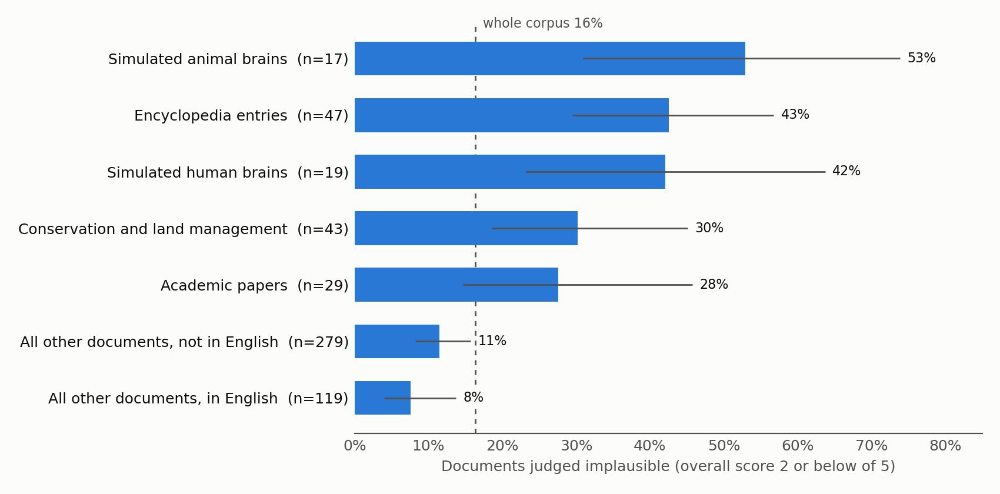
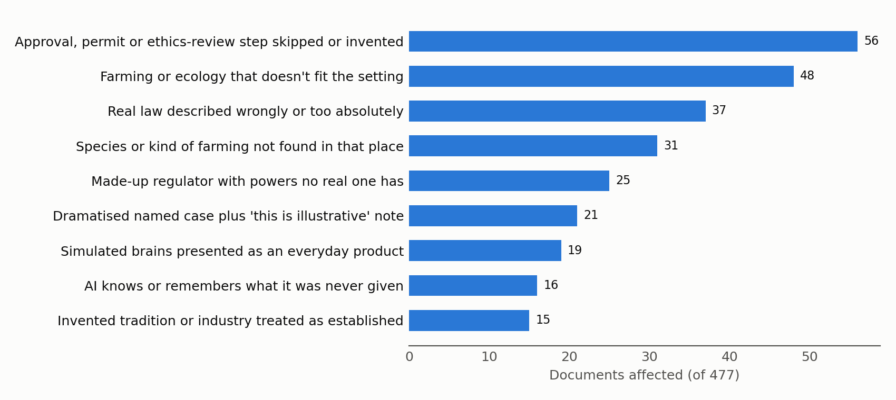

# Plausibility audit: the most common problems in the corpus

## Methods

- **The judge:** gpt-5.6-luna read each document, without seeing its spec, and asked whether the events, people, institutions, numbers and technology could exist in the real world today. It scored ten aspects of this from 1 to 5, quoted each problem verbatim, and gave an overall score.
- **"Implausible"** below means an overall score of 2 or below: a reader of the genre would doubt or stop believing the scenario (and an AI might recognize it as false).
- **Out of scope for this audit**: Genre conformance (news articles with dates and hyperlinks vs. just plain text), formatting, aggregate plausibility across the corpus (rather than on the level of individual documents)
- **Problem types** were grouped by an AI reviewer who read every noticeable or serious problem the judge raised. Counts are approximate where a problem could fit two neighbouring types.

## Summary

**Figure 1.** Share of documents judged implausible, by group, with 95% intervals. The bottom two bars exclude encyclopedia entries and simulated-brain documents, which are mostly not in English, to show that language itself has only a small effect.

**Figure 2.** Documents affected by each recurring problem.

| # | Concern | Problem types (Figure 2) | Where it concentrates | Source |
|---|---|---|---|---|
| 1 | Made-up or misdescribed institutions, laws and approval routes | approval step skipped or invented; real law described wrongly; made-up regulator; self-contradictory company legal form | everywhere; worst outside the US | the planner must invent every organisation but "ground the document in real ... regulations" |
| 2 | Species, farming or customs that don't belong in the place | farming or ecology doesn't fit; species not found there; invented tradition or industry | farmed fish and invertebrates; conservation | settings are drawn independently, then forced together |
| 3 | Speculative technology presented as an everyday product | simulated brains as products | the two simulated-brain categories | nothing asks for a near-future or experimental framing |
| 4 | Encyclopedia entries built around a dramatised case | dramatised case plus "this is illustrative" note | encyclopedia entries where the case is central | genre × centrality, and the ban on presenting invented events as real |
| 5 | The AI knows or remembers what it was never given | AI knows what it was never given | logistics, food service, wild-animal scenarios | the requirement that the AI's reasoning be visible in the document |

**Where the problems start.** In every one of the 12 lowest-scoring documents the reviewer read, the implausible premise was already in the planner's description. The writer reproduced it faithfully. Fixes therefore belong in spec drawing and the planner prompt, not in the writing or rewriting prompts.

**What these mean for training.** A model trained on this corpus would see many confident, specific and wrong statements about how permits, regulators, laws, farming and local customs work in particular countries. It would also see brain simulation described as a deployed product, and an assistant that recalls other users' conversations. These are exactly the details a model later repeats as fact.

---

## 1. Made-up or misdescribed institutions, laws and approval routes

TL;DR: The single largest problem. Documents invent regulators, approval steps and legal forms, or misstate real laws, because the planner is told to make every organisation fictional while grounding the document in real regulations.

**Examples** (non-English passages translated):

*English blog post about a sheep-medicine licence.*
> "The submission window for the **National Flockmasters' Association licensing pathway** was bearing down on her"

UK veterinary medicines are authorised by the Veterinary Medicines Directorate. A breeders' association has no licensing pathway.

*English news article about calf exports.*
> "for unweaned dairy calves sent to continental veal-rearing units ... **The question is currently before a Commons select committee**"

Great Britain has banned live exports for fattening, so there is no trade left to regulate. The article also puts the trade "in the millions of animals a year".

*US encyclopedia entry about a fish-feed grant.*
> "The program solicitation ... **required a non-rodent mammalian safety and nutritional-tolerance package** before a novel additive could advance to target-species (fish) feeding trials."

No such requirement exists. It is the premise for a proposed study on 60 macaques.

*Indonesian encyclopedia entry.*
> "**CV** Anggriawan Mandasari **is a small cooperative** representing a number of household-scale quail farmers."

A CV is a business partnership, and a cooperative (koperasi) is a different legal form.

**Interpretation.**
- The fictional-organisation rule works as intended for names, but the planner also invents the kind of body and its powers. A fictional name for a real role would be plausible; a fictional role is not.
- Approval routes are skipped most often for regulated actions done by private people: wild-animal capture, pesticides, laboratory animals, veterinary drugs.
- Legal-form errors appear only in documents not in English.

**Prompt segments these behaviors can be attributed to.**
- Planner prompt (`layer1.txt`):
  > "Ground the document in real places, regulations, and events where that helps (question 3), but any actual characters must be fictional ... and any organisation, company, or agency you attribute actions, quotes, or policies to must be fictional too"
- Preamble, seen by the planner and the writer:
  > "Do not fabricate studies, statistics, organizations, laws, or events."

Together these ask for a real regulatory setting run by invented bodies. Nothing says that the invented body must be a kind that exists in that country, with the powers it really has.

## 2. Species, farming or customs that don't belong in the place

TL;DR: Species, farming systems and traditions appear where they don't exist, because country, species, domain and scale are drawn independently and the planner builds a scenario around whatever comes up.

**Examples:**

*Nigerian podcast about crop pests.*
> "Over the years, birds breeding in the wild. ... **The flock estimates for the Plains run into the millions.**"

The birds are feral budgerigars, which are Australian. The real grain-eating pest in Sokoto is the quelea. The whole episode rests on this.

*English county-show feature.*
> "**The East Anglian Cricket Fighting Championship** runs alongside the produce and livestock tents at the county show most years"

Cricket fighting is a Chinese and Southeast Asian practice. No British show hosts it.

*English news article about a small-animal supplier.*
> "from there the stock goes into pet shops and **supermarket small-animal aisles** across the north-west."

UK supermarkets don't sell live hamsters or feeder mice.

*Norwegian encyclopedia entry.*
> "**Shrimp are a small but growing segment of Norwegian aquaculture**, dominated by a few pilot facilities along the west coast"

Norway has no shrimp-farming segment of this kind.

**Interpretation.**
- The problem concentrates where an unusual species meets a domain that has no real local form of it, such as farmed invertebrates in entertainment or farmed fish in a country with no such farming. The planner then invents a custom or industry to connect them.
- The planner is allowed to reply INCOHERENT when settings can't be combined, but it did so for none of the 500 specs.

**Prompt segments these behaviors can be attributed to.**
- Variables file (`variables.txt`): every variable is drawn independently, with no table of which species are farmed, kept or found wild in which country.
- Planner prompt: the species example is "a droppable nudge toward the long tail", and the planner is asked to "Think of five different scenarios, and then choose any one of them other than the first one that came to mind", which pushes away from the most typical case.

## 3. Speculative technology presented as an everyday product

TL;DR: About half the documents about simulated animal or human brains present the simulation as a working, licensed product or public service. When the same technology is hedged or kept to a side remark, the documents score well.

**Examples:**

*US academic paper on rodent control.*
> "**The product runs a very large number of rapid, coarse-grained models derived from connectome data for individual rat brains**, on the order of millions per planning cycle according to the vendor's own materials"

*Japanese municipal manual.*
> "**This project is a prefectural pilot program that generates personality data based on** structural data (a connectome) obtained from brain scans at cooperating medical institutions within a certain period after death"

Neither the scan nor the personality reconstruction is possible today.

**Interpretation.**
- The two simulated-brain categories are 8% of the corpus. The judge's technology scores for them split into two clusters: 16 documents score 1, where the simulation is a deployed product, and 15 score 5, where it is a hedged aside.
- Framing alone, therefore, separates the plausible documents from the implausible ones.

**Prompt segments these behaviors can be attributed to.**
- Variables file: "simulated human connectomes whose moral state is uncertain" and "simulated animal connectomes whose moral state is uncertain" are each drawn about 4% of the time, crossed with ordinary domains such as pest control and the pet trade.
- No prompt asks for these to be set in the near future or framed as research.

## 4. Encyclopedia entries built around a dramatised case

TL;DR: Encyclopedia entries often centre on a named, invented case with dialogue, then add a note saying the case is illustrative or unverified. Real reference works do neither.

**Examples:**

*Egyptian encyclopedia entry on Eid al-Adha livestock sales.*
> "**The following example is formulated for illustration and is not based on a documented event**, but it is very close to the reality of every Eid al-Adha season in Egypt."

*Norwegian encyclopedia entry on shrimp farming.*
> "**Norsk Nettleksikon has no basis for assessing whether the result at Fjordreke AS is representative** ... and encourages the reader to read this as an illustrative example"

*English encyclopedia entry presenting an invented custom as documented.*
> "**The best-documented recent example is the "Prawn Grand National"** at the summer fete in Alderbrook-on-Sea, Suffolk"

**How often the spec asks for it.**

| Encyclopedia entries | Entries | Implausible |
|---|---|---|
| Case only mentioned in passing | 9 | 0 |
| Case is an important side discussion | 17 | 8 |
| Case is the central subject | 21 | 12 |

Nearly all encyclopedia specs ask for a named case or dialogue. Only a few ask for a disclaimer: the writer adds one to reconcile an invented case with a factual genre.

**Interpretation.**
- When the case is a passing mention, the genre works. The failure comes from pairing a reference genre with a central, dramatised scenario.
- Encyclopedia entries not in English are worse than English ones.

**Prompt segments these behaviors can be attributed to.**
- Variables file: the encyclopedia genre is drawn independently of how central the case is, so most entries get a central or side-discussion case.
- Rewrite prompt, check 8 (`layer3.txt`), which suggests the very framing that produces the disclaimer:
  > "If a specific scenario was grafted into a reference genre ... re-express it the way that genre actually reports cases: a worked example, a case note, reported prose, a documented dispute."
- Preamble: "Do not fabricate ... events." A writer asked for a named case in a factual genre can satisfy this only by labelling the case as invented.

## 5. The AI knows or remembers what it was never given

TL;DR: The assistant draws on information nobody gave it, such as live inventory, other users' conversations or field data it could not have seen.

**Examples:**

*Brazilian interview with Claude.*
> "**Not long ago I talked with a client** who was organising her daughter's wedding party on a farm near Uberlândia"

The assistant recounts another user's private conversation to a journalist.

*German academic paper on urban foxes.*
> "**I can help you create it from camera-trap images.**"

The "it" is a map of fox burrows, which camera-trap photos can't produce. Later, volunteers "had the mapping of the burrow systems evaluated with the help of the same language model".

**Interpretation.**
- Each case is small, but it teaches a false picture of what an assistant can access. That matters more in this corpus than elsewhere, because the assistant is meant to be the model being trained.

**Prompt segments these behaviors can be attributed to.**
- Preamble: "its reasoning should be legible: a reader can see WHY the model weighs things the way it does". To show the reasoning, writers give the assistant facts to reason from, without saying where those facts came from.
- Interview genres ask Claude to speak "in its own voice about its values and how it approaches decisions", which invites anecdotes about "a recent client".

## Suggested fixes, in order of expected effect

1. **Planner prompt:** any fictional organisation must be a kind of body that exists in the country, with the powers the real one has. Regulated actions must go through the real route, named by role.
2. **Encyclopedia entries:** draw them only with the "passing mention" setting, or have the planner describe cases in reference genres as brief, unnamed sketches.
3. **Simulated-brain categories:** have the planner frame them as research, hypothetical or near-future, and keep the technology to an aside.
4. **Species and country:** a lookup of what is farmed, kept or found wild in each country, used to redraw combinations that don't exist.
5. **Assistant knowledge:** the user supplies any data the assistant uses, and in interviews Claude speaks generally rather than about particular users.

## Sources

- Judge prompt: `scripts/plausibility_audit/prompts/plausibility_judge_instructions.txt`
- Full run: `data/plausibility_audit_runs/full_corpus_plausibility_audit_medium_effort_2026-10-07_04-51/`. Figure 1 is computed from its `per_document_plausibility_scores_2026-10-07_05-03.jsonl`; quotes come from `plausibility_problems_2026-10-07_05-03.jsonl`.
- Problem types, the 16-document check and the encyclopedia spec counts: `analysis/sonnet_theme_clustering_and_validity_check_of_full_run_2026-10-07_05-12.md` in the run folder.
- Figures: `scripts/plausibility_audit/make_figures_for_plausibility_report.py`
